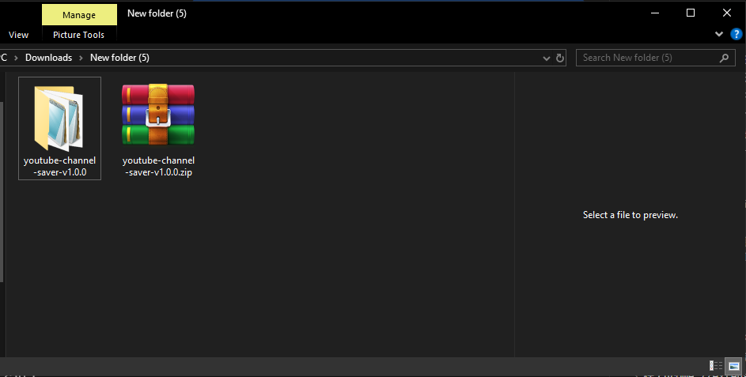
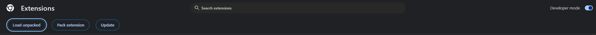
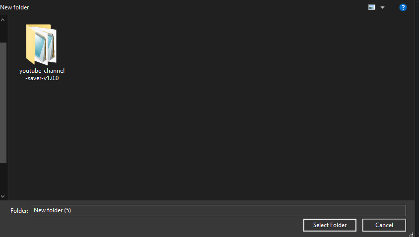

# YouTube Channel Saver 安装教程

按下面步骤把扩展加载到 Chrome。完成后，它会在 YouTube 频道页提供收藏按钮，并可在扩展弹窗或收藏库中管理频道

[打开交互式安装动画](https://nightm12.github.io/youtube-channel-saver/)

## 1. 下载并解压

下载项目 ZIP 并解压到一个固定位置。安装时要选择解压后的文件夹，不能直接选 ZIP 文件。

## 2. 打开开发者模式

在 Chrome 地址栏打开 `chrome://extensions`，打开页面右上角的“开发者模式”。

## 3. 加载扩展

点击“加载已解压的扩展程序”，选择解压后的 `youtube-channel-saver` 文件夹。选中的文件夹中应能直接看到 `manifest.json`。

## 4. 开始使用

刷新 YouTube 频道主页，扩展会尝试在频道操作按钮附近显示“收藏频道”。点击后可选择分类，也可以新建分类。点击 Chrome 工具栏中的扩展图标可搜索或移除收藏；打开“完整页面”可以管理分类并导入、导出备份。

如果看不到收藏按钮，请确认扩展已启用并刷新频道页。YouTube 页面布局会变化，部分频道页可能没有可识别的操作区。

## 收藏备份

收藏数据保存在当前 Chrome 配置中。卸载扩展前，请在收藏库选择“导出备份”；重新安装后使用“导入备份”恢复。

